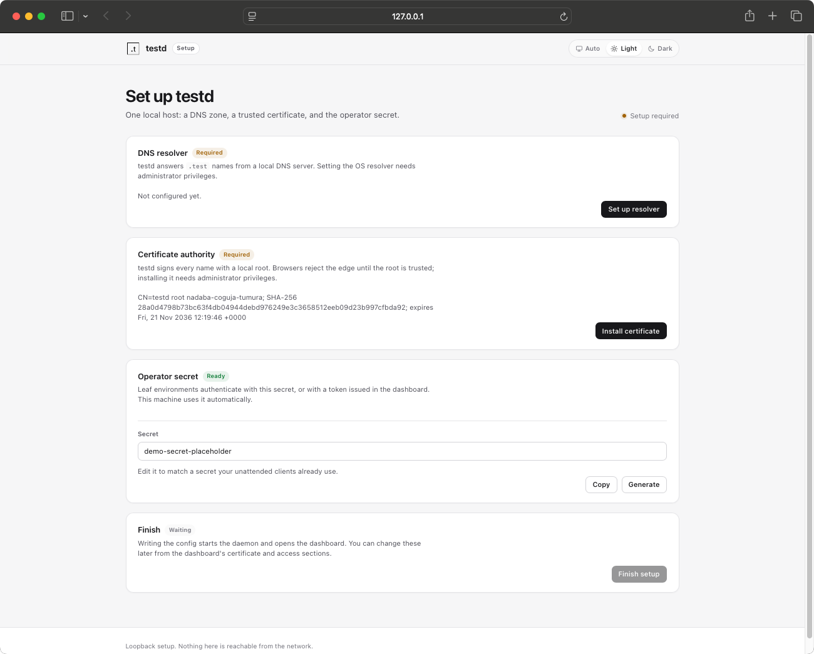
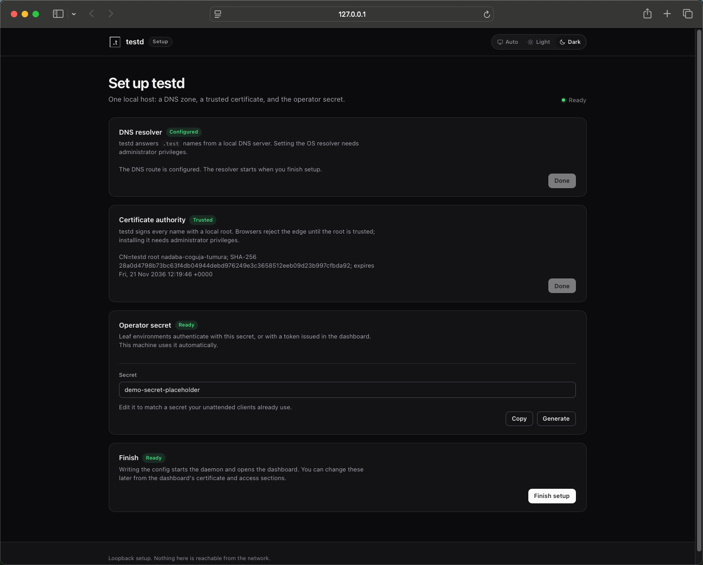
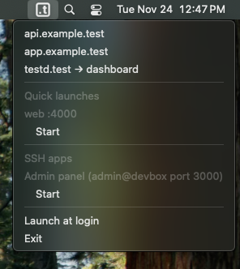
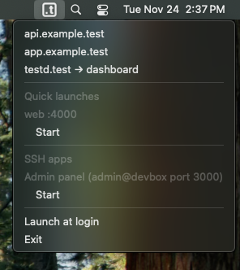
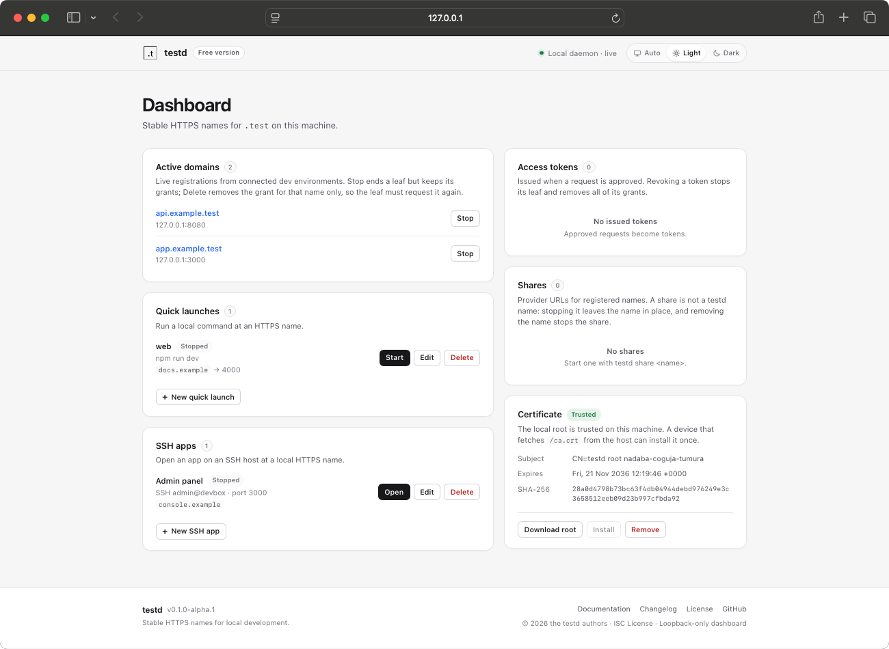
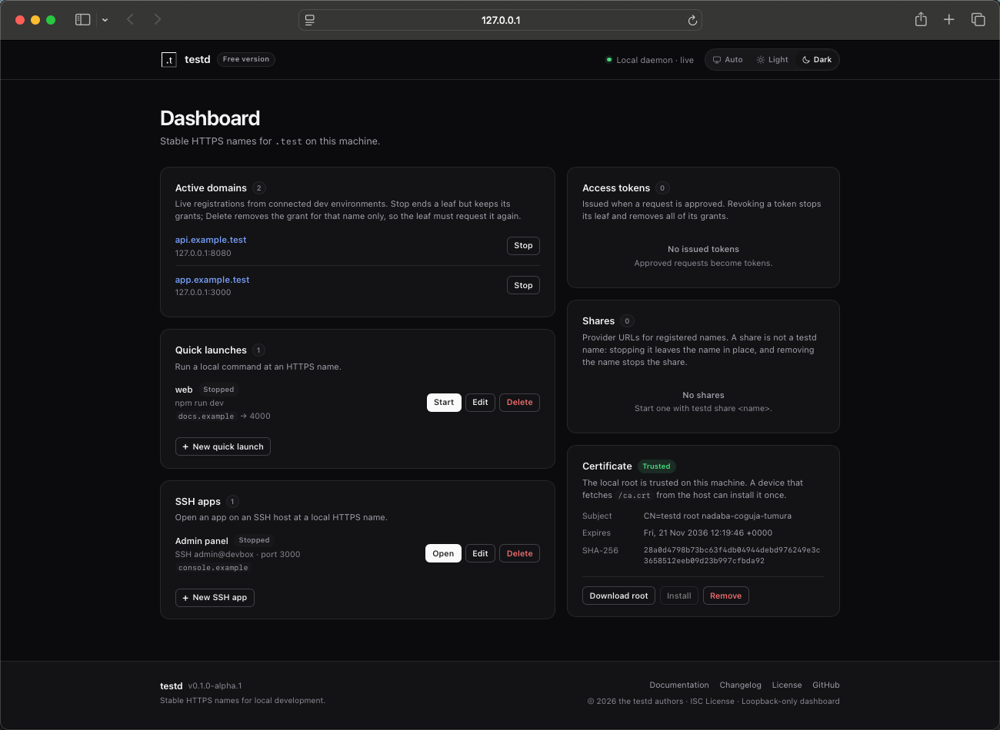

# Running the host

The **host** is the machine with your browser. It runs the daemon that answers `.test` DNS queries, terminates HTTPS with your local CA, stores issued leaf tokens, and serves the local web dashboard.

You can run the host either with the **desktop tray app** or headlessly with **`testd host`**. Both use the exact same config directory (`~/.config/testd/` on Linux/macOS, `%APPDATA%\testd\` on Windows), local CA, tokens, quick launches, and SSH apps. Only one host daemon can run at a time per user.

## Desktop tray app

### First-run setup

When you launch the desktop app without an existing host configuration, it starts a temporary setup server on an ephemeral loopback port and opens a guided setup page in your default browser:

{.light-only}
{.dark-only}

1. **DNS resolver**: configures the OS `.test` resolver route so `*.test` names reach testd's local DNS server. Requires administrator privileges.
2. **Certificate authority**: creates the local root CA and installs it in your system trust store. Requires administrator privileges. If you open the page in Firefox, it also notes that the dashboard checks Firefox trust separately after setup.
3. **Operator secret**: pre-filled with a generated pronounceable secret (at least 16 characters). You can copy it, click **Generate** for a new one, or edit it to match a secret your unattended clients already use.

Once both system checks are green and the secret is at least 16 characters, click **Finish setup**. testd writes your configuration, starts the host daemon, and redirects that same browser tab to the dashboard.

If you close the setup tab before finishing, the tray stays running with **Continue setup** (reopening the page with your pending secret preserved) and **Exit** (stopping the setup server).

### The tray menu

Once the daemon is running, click the tray or menu-bar icon for live state and common actions:

{.light-only}
{.dark-only}

- **Repair actions** (shown only when a check fails): **Set up DNS** and **Trust certificate** run the same privileged repairs as `testd doctor --fix`.
- **Active domains**: lists every currently registered `.test` name; clicking one opens it in your browser.
- **`testd.test → dashboard`**: opens the authenticated local dashboard in your default browser.
- **Quick launches**: lists saved local commands with **Start** and **Stop** actions.
- **SSH apps**: lists saved remote SSH apps with **Start** and **Stop** actions.
- **Shares**: lists active tunnels with a link to open the shared URL and **Stop sharing \<name\>**.
- **Launch at login**: toggles starting the desktop app when you sign in.
- **Exit**: stops the daemon, any running quick launches, SSH apps, and shares started by the daemon, and closes the tray app.

### Icon states and notifications

| Icon state | Meaning |
|---|---|
| Normal | Resolver and root trust are healthy, and no access requests are waiting |
| Request badge | A remote leaf is waiting for pairing or publishing approval |
| Alert badge | The `.test` resolver or root certificate trust needs repair |

While running, the daemon re-checks the resolver every 10 seconds and root trust every 60 seconds (plus immediately after any repair). On a desktop session, failures and incoming access requests raise desktop notifications; clicking a repair notification runs the fix through the `testd://` URL handler (`testd://fix/resolver` or `testd://fix/certificate`).

### Launch at login

**Launch at login** is off by default on a fresh install and writes no OS login entry until you tick it:

| Platform | Login entry location |
|---|---|
| macOS | `~/Library/LaunchAgents/dev.testd.host.plist` |
| Linux | `~/.config/autostart/dev.testd.host.desktop` |
| Windows | `HKCU\Software\Microsoft\Windows\CurrentVersion\Run` (`dev.testd.host`) |

Unticking **Launch at login** or removing the entry externally keeps it off on future restarts. If a customized or conflicting entry already exists at that path, testd leaves it untouched rather than overwriting it.

### URL scheme (`testd://`)

Release builds register the `testd://` URL scheme so notifications and links can route repair actions to the running app:

```text
testd://fix/resolver
testd://fix/certificate
```

- On macOS, Launch Services reads the scheme from `Testd.app`'s `Info.plist`.
- On Linux and Windows, the desktop app registers the per-user handler on startup (leaving any conflicting custom handler untouched). Dev builds skip registration unless `TESTD_REGISTER_SCHEME=1` is set.
- You can also invoke the same actions from the CLI with `testd url <url>` (forwards to the running daemon, or runs the repair itself using a native authorization dialog when there is no terminal).

## Headless CLI and system services

If you prefer running the host without the tray app:

```sh
testd init
testd doctor --fix
testd host
```

`testd host` runs the daemon in the foreground and logs health notices as `[notice]`. For background startup, templates are included under `packaging/`:

- **Linux (systemd):** use `packaging/systemd/testd@.service` to run as your user with `CAP_NET_BIND_SERVICE` for port `443`, or `packaging/systemd/testd.service` (which sets `NoNewPrivileges=yes`) paired with a high `edge_addr`.
- **macOS (launchd):** see `packaging/launchd/dev.testd.host.plist`.

See [Privileged ports](system.md#privileged-ports) for port `443` setup details on Linux and macOS.

## The dashboard

Both the desktop app and `testd host` serve the same local web dashboard. The desktop app does not bundle a webview; it opens the dashboard in your default HTTP browser using an owner-private HTML handoff file so admin tokens never appear in process arguments.

- **From the desktop app:** click **`testd.test → dashboard`** in the tray menu.
- **From the CLI:** run `testd dashboard` in the same user account that owns the daemon to print the authenticated URL.

The bootstrap token is passed in the URL fragment, stripped from browser history on load, and kept in origin-scoped session storage. Restarting the daemon invalidates the session, and visiting bare `http://127.0.0.1:7737/` or `https://testd.test/` without a valid session does not expose live state or admin controls. Every mutating request also requires `X-Testd-Request: 1`.

{.light-only}
{.dark-only}

Inside the dashboard:

- **Live names**: currently registered names, with **Stop** (ends the connection, keeps the grant) and **Delete** (stops the name and removes its grant)
- **Quick launches**: saved local commands you can start, stop, and inspect live stdout/stderr logs for (see [Quick launches](local.md#quick-launches))
- **SSH apps**: saved remote apps over OpenSSH, with **Open**, **Stop**, and interactive SSH prompts (see [SSH apps](remote.md#ssh-apps))
- **Shares**: active tunnel URLs, with **Start** and **Stop** controls (see [Sharing & tunnels](sharing.md))
- **Access**: pending remote pairing and publishing requests, with **Approve** and **Deny**
- **Tokens**: issued leaf tokens, with **Revoke**
- **Certificate**: system trust status, SHA-256 fingerprint, expiry, install/remove buttons, and a separate Firefox trust check when opened in Firefox
- **Updates**: installed version, release check status, **Check now**, a persistent **Check for updates** switch, and **Download update** when a newer version is available

The dashboard only responds on loopback (`https://testd.test/` is forwarded by the edge for local clients only). Foreign `Host` headers and non-loopback peers are rejected even with a valid credential.

### Update checks

The desktop app and `testd host` check `https://testd.dev/update.json` over HTTPS at startup and every 24 hours. The feed uses the same published version as the website installer, including alpha releases. The tray shows **Update to VERSION...** when a newer version is available; the dashboard provides the download link and check status. Requests contain no local configuration, credentials, or installation identifier; the server receives the ordinary network address and a fixed `testd-update-check` user agent. Checks require `curl`, which is included with supported macOS and Windows hosts.

Turn off **Updates → Check for updates** in the dashboard to cancel an active check and prevent further checks, including **Check now**. The preference persists across restarts in `updates.json` in the config directory. To disable checks before first startup, create that file with `{"enabled":false}`. Command-line leaves (`testd run`) and SSH helpers do not check for updates.

**Download update** opens the matching GitHub release. Download the package for your platform, verify `SHA256SUMS`, quit testd, and install the new version using the same method as before. Keep the existing configuration to retain your certificate, credentials, saved launches, and login preference. Package-manager installs should use their package manager's upgrade command. testd does not replace running executables or install updates automatically.

### API access and root certificate download

For scripts talking to `/api/status` or other dashboard endpoints, read `client_addr` and `dashboard_token` from the owner-private `control.json` and send `Authorization: Bearer <dashboard_token>` (keep credentials out of command lines and logs).

The public root certificate is always available without authentication at `/ca.crt`:

```sh
curl http://127.0.0.1:7737/ca.crt -o testd-root.crt
```

## Mixing the desktop app and the CLI

Because both binaries share the same config directory and daemon state:

- Run the desktop app on your browser machine instead of `testd host`, and use `testd run` in any local terminal or remote dev environment.
- Changes made in the CLI (`testd requests`, `testd tokens`, `testd share`, `testd doctor --fix`) show up live in the tray menu and dashboard, and vice versa.
- Do not run `testd host` or a system service at the same time as the desktop app; the instance lock allows only one daemon per user, so a second instance exits immediately.
