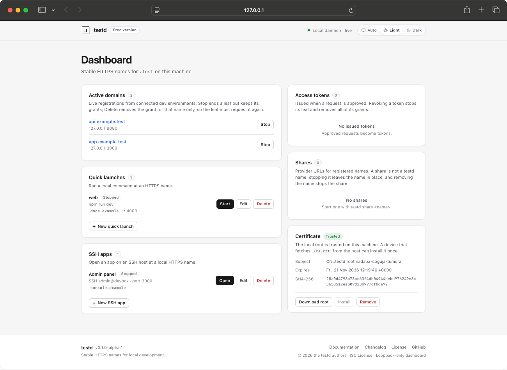

# Daily usage

Once your host daemon is running, day-to-day work comes down to registering names, managing them in the dashboard, and optionally sharing a name over a tunnel.

## Register a name

The most common command is:

```sh
testd run app.example:3000
```

Here are all the ways to specify what to register:

| Entry | What it registers |
|---|---|
| `:3000` | Uses the current directory name; targets port `3000` on this machine |
| `app.example:3000` | Registers `app.example.test`; targets port `3000` on this machine |
| `10.0.0.5:app.example:3000` | Registers `app.example.test`; targets `10.0.0.5:3000` explicitly |
| `app.example.test:3000` | Same as `app.example:3000` (a trailing `.test` is stripped) |

You can publish multiple services in one command:

```sh
testd run frontend:3000 api:8080
```

All entries in one `testd run` share a single connection, token, and grant list.

To tie the names to your dev server process, add `--` followed by the command:

```sh
testd run app.example:3000 -- npm run dev
```

The names stay live while the command runs and disappear as soon as it exits or you press Ctrl+C. `testd run` exits with your command's exit code.

**How bare ports are resolved:**

- On a **local** run, `:3000` targets `127.0.0.1:3000`.
- On a **paired remote leaf**, `:3000` targets `127.0.0.1:3000` on the leaf itself (the leaf forwards traffic from the host over mutual TLS to its own loopback).
- If you pass an explicit target host on a local-only registration, the host must be able to reach that address directly.

## Names and targets

Write names as `<service>.<project>` without the `.test` suffix. The daemon stores and displays the bare name (for example `app.example`), and browsers open `https://app.example.test`.

**Why two labels matter:** `app.example.test` and `api.example.test` share a registrable domain, so cookies and SameSite rules behave just like `app.example.com` and `api.example.com`. A single-label name like `app.test` is treated as cross-site with every other project, so `testd` prints a warning when you use one.

A few rules to keep in mind:

- Labels may contain ASCII letters, digits, and hyphens, and cannot start or end with a hyphen.
- Each label can be up to 63 bytes, and the full name up to 253 bytes.
- `testd.test` is reserved for the local dashboard (reachable only from this machine).
- Targets can be a bare port, `host:port`, `ip:port`, or `[ipv6]:port` (port `0` is rejected).

**What your app receives:** DNS always points registered names at the host, not directly at the app. The built-in edge speaks HTTP/1.1 and supports WebSocket upgrades (so HMR works out of the box), forwarding the original `Host` header along with `X-Forwarded-For` and `X-Forwarded-Proto`.

## How long a name lives

Think of the TCP connection as the lease:

- Press Ctrl+C, stop the wrapped process, or lose the network, and the host releases those names automatically.
- If the network drops, a running leaf reconnects every few seconds and re-registers its names without needing approval again (as long as its token and grants still exist).

Different actions in the dashboard and CLI affect tokens, grants, and live names differently:

| Action | What happens |
|---|---|
| **Stop** (dashboard) | Ends the leaf connection now, but keeps its token and grants. The next run works immediately without re-approval. |
| **Delete** (dashboard) | Stops that one name and removes it from the token's grant list. Other names on the leaf keep running; publishing that name again will ask for approval. |
| **Revoke token** (dashboard or `testd tokens --revoke <id>`) | Deletes the token, closes every connection using it, releases all of its names, and tells the leaf to forget its saved credential. |

If another connection already owns a name and you intentionally want to take it over, pass `--force`:

```sh
testd run --force app.example:3000
```

Without `--force`, a duplicate name fails and reports the current owner's connection id.

## The dashboard

To open the dashboard from the CLI (in the same user account that owns the daemon):

```sh
testd dashboard
```

If you use the [desktop app](desktop.md), click **`testd.test → dashboard`** in the tray or menu-bar menu instead.

The printed URL carries a one-run bootstrap token in its URL fragment. As soon as the page loads, it strips the token from your browser history and stores it in origin-scoped session storage. Restarting the daemon invalidates the session, and visiting bare `http://127.0.0.1:7737/` or `https://testd.test/` without a valid session does not expose live state or admin controls. Every mutating request also requires the `X-Testd-Request: 1` header.

Inside the dashboard you will find:



- **Live names**: currently registered names, with **Stop** and (for issued grants) **Delete**
- **Shares**: active tunnel URLs, with a **Stop** button
- **Access**: pending pairing and name-grant requests, with **Approve** and **Deny**
- **Tokens**: issued leaf tokens, with **Revoke**
- **Quick launches**: saved local commands you can start, stop, and inspect logs for
- **SSH apps**: saved remote apps over SSH, with **Open**, **Stop**, and interactive SSH prompts
- **Certificate**: system trust status, SHA-256 fingerprint, expiry, install/remove controls, and a separate Firefox trust check when opened in Firefox

Quick launches run without a console window on Windows. Expand **Output** under a launch to view its live stdout and stderr, labeled by stream. The dashboard keeps the latest 500 lines from the current or most recent run, including after the command stops. Starting the launch again or restarting the daemon clears that output.

The dashboard only responds on loopback (and `https://testd.test/` is forwarded by the edge for local clients only). Foreign `Host` headers and non-loopback peers are rejected even with a valid credential.

### SSH apps in the dashboard

**SSH apps** let you open a remote dev server as a local `https://<name>.test` URL using your normal OpenSSH setup (`~/.ssh/config`, keys, passphrases, 2FA prompts):

- **Forward an existing app:** Enter the SSH host alias, remote port, and local name, then click **Open**. Needs only OpenSSH on the remote host.
- **Start a remote command:** Have testd start and stop the dev server on the remote machine over the same SSH connection. Before starting, testd checks `~/.local/bin/testd` and the remote `PATH` for a matching testd version. If it is missing or different, the dashboard prompts you to approve installing that version into `~/.local/bin/testd` (cancelling leaves the remote host untouched).

A few details about starting remote commands and automatic install:

- Remote command execution targets **Linux and macOS** SSH hosts. Windows works as the local client, but starting commands and auto-installing on native Windows SSH hosts are not supported.
- Automatic installation supports Linux `x86_64` and macOS `x86_64` / `arm64`. It downloads the matching version-pinned CLI release from GitHub over HTTPS, verifies its `SHA256SUMS` entry, and backs up any existing `~/.local/bin/testd` under `~/.local/share/testd/backups`.
- The remote host needs a POSIX shell, `tar`, `curl` or `wget`, and `sha256sum` or `shasum`. No root privileges or remote `PATH` edits are needed because testd invokes the installed binary by its full path.

### API access and root certificate download

For scripts talking to `/api/status` or other dashboard endpoints, read `client_addr` and `dashboard_token` from the owner-private `control.json` and send `Authorization: Bearer <dashboard_token>` (keep credentials out of command lines and logs).

The public root certificate is always available without authentication at `/ca.crt`:

```sh
curl http://127.0.0.1:7737/ca.crt -o testd-root.crt
```

## Check and repair

Run `testd doctor` any time something looks off:

```sh
testd doctor
testd doctor --json
testd doctor --fix
```

`doctor` checks your config, operator secret, OS resolver route, actual `.test` DNS resolution, optional Caddy integration, PKI validity, and the HTTPS edge. (PKI is always required for registration TLS even when the built-in browser edge is disabled; OS root trust is required only when the built-in edge is enabled.)

| Exit code | Meaning |
|---|---|
| `0` | Everything is ready |
| `1` | Missing or invalid configuration or state |
| `2` | Resolver route or `.test` DNS resolution is broken |
| `3` | PKI, certificate trust, or the HTTPS edge is not ready |

`testd doctor --fix` applies privileged repairs: configures the OS resolver, writes a missing operator secret, adds the Caddyfile import and reloads Caddy if configured, and installs or reinstalls the root certificate.

While the daemon runs, it automatically re-checks the resolver every 10 seconds and root trust every 60 seconds (plus immediately after any repair). On a desktop session, failures pop up as notifications you can click to trigger the repair; in headless mode, they are logged as `[notice]`.

## Share a name

`.test` names only resolve on your host machine. When you need to test on a phone, receive a webhook, or show a colleague, share a live name through a tunnel:

```sh
testd share app.example
testd share app.example --provider tailscale
testd share --list
testd share --stop app.example
```

| Provider | Who can reach it | What you need installed |
|---|---|---|
| `cloudflared` (default) | Public internet | `cloudflared` on `PATH` (no account needed for quick tunnels) |
| `ngrok` | Public internet | `ngrok` on `PATH` (run `ngrok config add-authtoken` once) |
| `tailscale` | Your tailnet | `tailscale` on `PATH` |

All providers route through the daemon's plain HTTP listener (`http_addr`), even when an external front handles TLS.

The daemon owns the tunnel process, so closing your terminal will not drop the share. A share stays up until you stop it, or until the name's owning connection or target changes (reconnecting to the same target also ends the share, so share again afterward; repeating an unchanged registration on the same connection keeps it). You can also start and stop shares from the dashboard's **Shares** card and the tray menu.

Remember: a public share (`cloudflared` or `ngrok`) exposes your local app to anyone with the URL, and a Tailscale share is as private as your tailnet.

## Access requests and tokens

Remote leaves connect over TLS 1.3 and need two separate approvals the first time:

1. **Pairing** (`testd pair <host>`): establishes trust in the host's identity using matching verification codes on both sides. Pairing does not grant permission to publish names.
2. **Publishing grant** (`testd run --host <host> ...`): asks the host for permission to publish specific names.

On the host, inspect and decide pending requests with:

```sh
testd requests
testd approve <id>
testd deny <id>
```

You can also approve or deny from the dashboard's **Access** card or desktop tray notifications. Requests include the leaf label (for example `user@host:example`), requested names, source address, and age, and expire after two minutes. If a request is denied or expires, just run the leaf command again to send a fresh request.

Tokens are scoped to exact names. If an already-approved leaf later tries to publish a new name, the host queues a request for just that one name and holds the registration until you decide. Approving adds the new name to the existing token without disturbing its other names.

Manage issued tokens with:

```sh
testd tokens
testd tokens --revoke <id>
```

Token secrets are never printed. Multiple connections can reuse the same token and share its grants. Revoking a token closes every connection using it, releases its names, and makes the leaf discard its saved credential.

For unattended automation where interactive approval is not possible, you can pass the host's operator secret via `TESTD_TOKEN`:

```sh
export TESTD_TOKEN=<operator secret>
```

Because the operator secret grants access to any valid name and cannot be revoked per client, prefer an issued token for CI whenever possible. See [Credentials and profiles](advanced.md#credentials-and-profiles).

## Common workflows

| Goal | What to run or click |
|---|---|
| Move an app to another port | `testd run app.example:4000` |
| Run frontend and API together | `testd run frontend:3000 api:8080 -- npm run dev` |
| Restart a dev server | Restart the command; the name comes back automatically |
| Keep a name even if a server restarts | Run `testd run ...` without `--`, or use a dashboard **Quick launch** |
| Take over a stale or duplicate name | `testd run --force ...` |
| Pause a name temporarily | Dashboard **Stop** (next run registers without re-approval) |
| Remove permission for one name | Dashboard **Delete** on that name |
| Match production cookie scoping | Use `<service>.<project>` instead of a single label |
| Avoid port 443 | Set `[host] edge_addr` to a high port (for example `127.0.0.1:8443`) and include `:8443` in URLs |

## Troubleshooting

| Problem | Likely cause and fix |
|---|---|
| Browser shows a certificate warning | Root CA is not trusted yet; run `testd doctor --fix`. In Firefox, open the dashboard to check Firefox trust and import the root if prompted. |
| `.test` name does not resolve | OS resolver is not configured or `testd host` is not running; run `testd doctor`. |
| `404` from the edge | No live registration for that name: the leaf stopped, you clicked **Stop**, or its grant was deleted. |
| `502` from the edge | The host cannot reach the target: wrong port/address, remote server bound only to loopback without a paired leaf, or a firewall blocking it. |
| Duplicate name error | Another connection already owns the name; pass `--force` only if you want to take it over. |
| Authentication failed | Stale credential after revoking a token or resetting the host; delete `~/.config/testd/credentials/<profile>` and run again. |
| Access request expired | Nobody approved it within two minutes; run `testd run` again. |
| `port 53 already in use` on Windows | Another local DNS service owns UDP port 53; stop it so testd can bind `.test` DNS. |
| `nothing is serving HTTPS` | Start `testd host` and check `edge_addr`; on Linux, port 443 needs `CAP_NET_BIND_SERVICE` or a high port. |
| `no daemon is running` | Start `testd host` or the desktop tray app; the dashboard, shares, requests, and tokens live in the daemon. |
| Share has no URL | Tunnel provider is missing, not authenticated (`ngrok`), or failed to report a URL; check the daemon logs. |

For full flag lists, config keys, and platform specifics, see the [Reference](reference.md).
